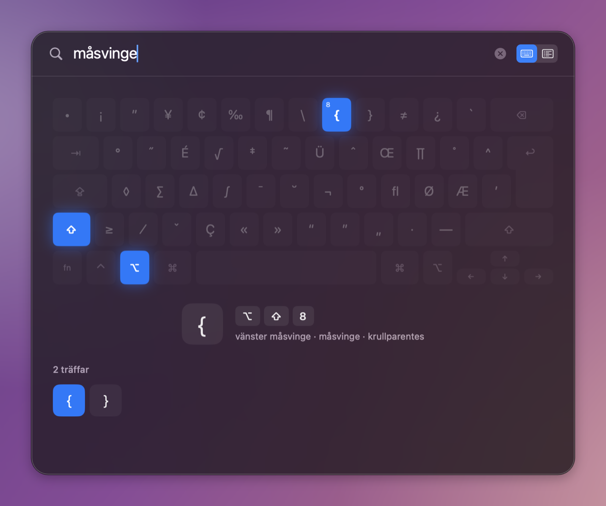
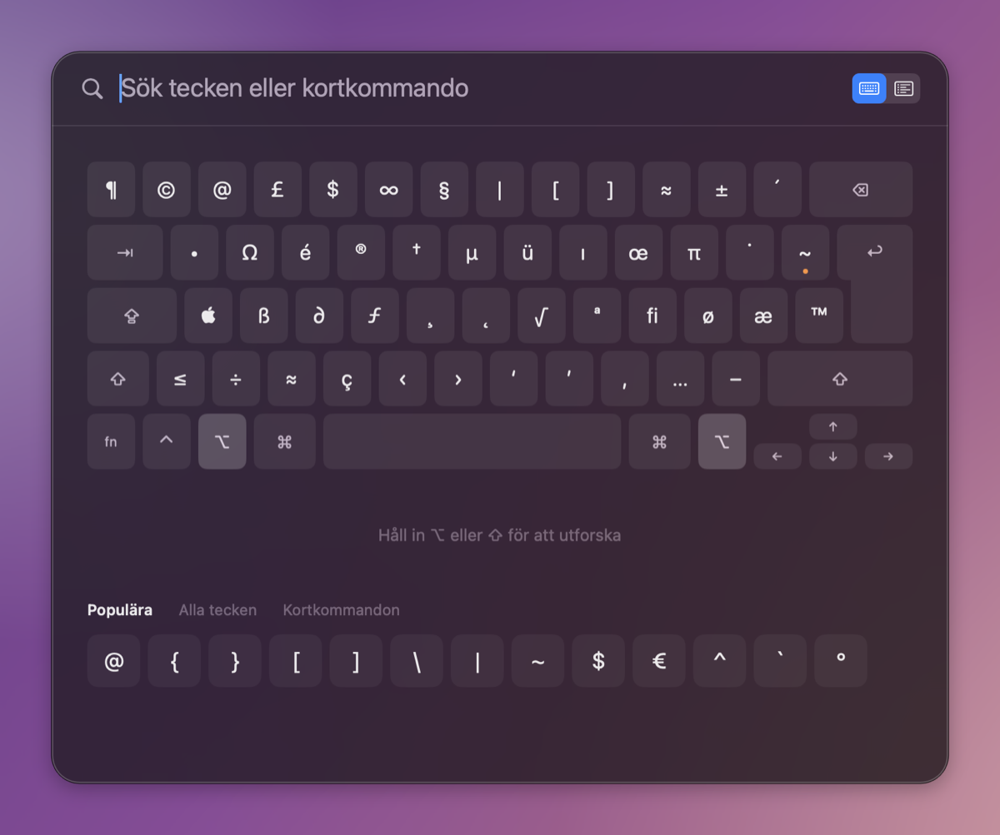
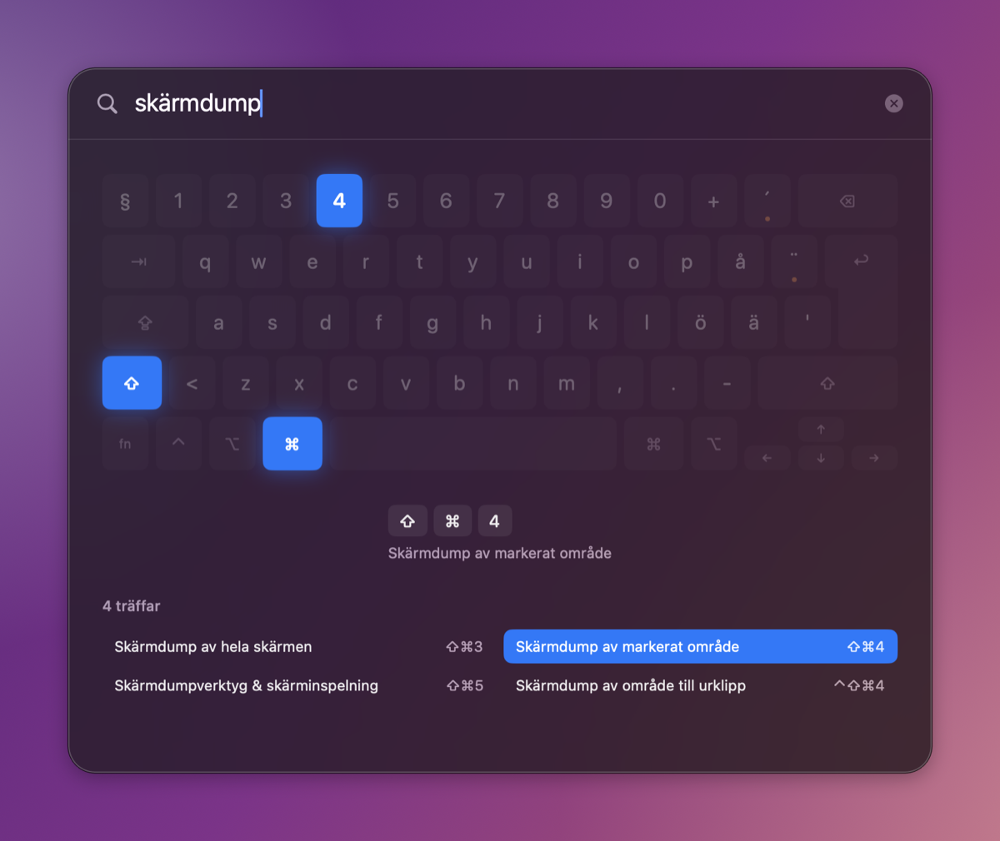

# Tangent

**Never hunt for `@`, `{`, `\` or `~` on a Mac keyboard again.**

Tangent is a menu bar app. **Double-tap ⌘** anywhere and a virtual keyboard shows exactly which keys to press for any character or shortcut. Double-tap and hold to peek: it disappears when you let go.


<table>
  <tr>
    <td></td>
    <td></td>
    <td></td>
  </tr>
  <tr>
    <td align="center">Search by name: <i>måsvinge</i> → <code>{</code></td>
    <td align="center">Hold ⌥ or ⇧ to see every key</td>
    <td align="center">Common Mac shortcuts</td>
  </tr>
</table>

- **Always correct:** reads your active keyboard layout, including dead keys like `⌥¨` then space → `~`.
- **Fast:** type, press ↩, and the character is copied. esc closes.
- **Light:** a native Swift app with no Dock icon. No permissions needed, unless you want the current app's shortcuts (see below).

## Cheat sheets

Press **⇥** in the helper to switch to cheat sheet mode. The first sheet lists every menu shortcut in the app you were using. Reading another app's menus needs Accessibility permission, which Tangent asks for the first time you open that sheet.

Your own sheets live in `~/.config/tangent` as `.md` or `.txt` files, and the search field searches all of them:

```markdown
# Vim

## Rörelse
gg / G       Början / slutet av filen
w / b        Nästa / föregående ord
```

`#` is the sheet's title (the file name is used if it's missing), `##` starts a section, and every other line is the keys, two or more spaces or a tab, then the description. Double-click a row to copy its keys.

## Download

Grab **Tangent.zip** from the [latest release](https://github.com/klppl/tangent/releases/latest), unzip, and move `Tangent.app` to Applications. Requires macOS 13+ and runs on Apple Silicon and Intel Macs.

The app isn't notarized, so the first time you open it macOS blocks it. Go to **System Settings → Privacy & Security** and click **Open Anyway**, or run:

```bash
xattr -dr com.apple.quarantine /Applications/Tangent.app
```

## Build from source

Requires the Xcode Command Line Tools.

```bash
./build.sh install
```

The script builds `Tangent.app`, copies it to `/Applications` and starts it. From the menu bar icon you can switch to double-tap ⌥ or ⌃, or set a custom combination.

## License

[The Lagom License](LICENSE): not too much, not too little.
